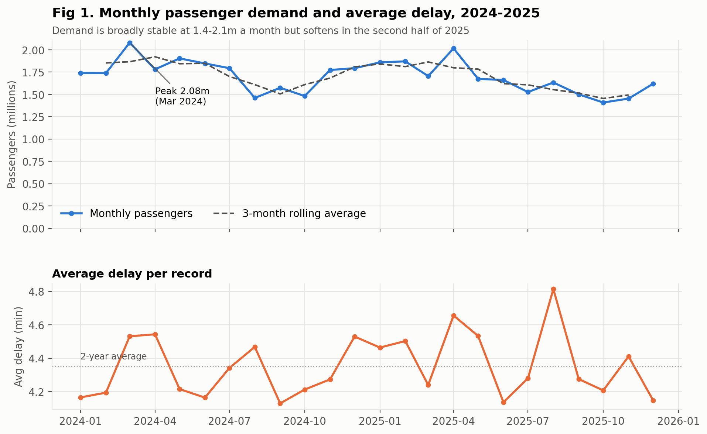
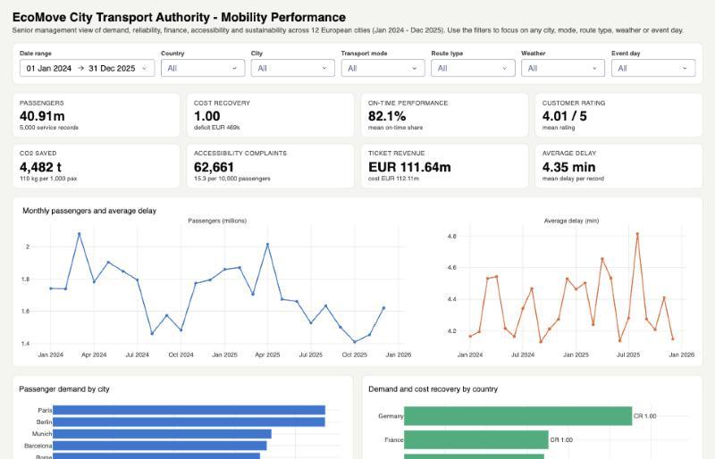

# EcoMove Mobility – Data Visualisation Project

COM7021 Data Visualisation. Python analysis and an interactive dashboard on the
EcoMove City Transport Authority dataset (public transport and shared mobility in
12 European cities, January 2024 – December 2025).

## Contents

| File | Purpose |
|---|---|
| `ecomove_analysis.py` | Loads and cleans the data, prints quality checks and summary tables, and saves eight figures to `figures/` |
| `ecomove_dashboard.py` | Interactive Plotly Dash dashboard with date, country, city, mode, route, weather and event-day filters |
| `EcoMove_Analysis.ipynb` | Local step-by-step notebook: load, inspect, quality checks, cleaning, summary tables and figures |
| `EcoMove_Colab.ipynb` | Step-by-step notebook for running everything in Google Colab |
| `figures/` | The eight static visualisations |
| `screenshots/` | Process screenshots (notebook run) and dashboard screenshots, unfiltered and filtered to snow days |

## Figures

1. Monthly passenger demand and average delay (time series)
2. Passenger demand by city (ranked bar chart)
3. Correlation between operational measures (heatmap)
4. Delay by weather condition (box plot)
5. Cost-recovery ratio by transport mode (lollipop chart)
6. Accessibility complaint rate by route type and mode (heatmap)
7. On-time percentage vs customer rating (scatter with trend line)
8. Event days vs normal days (small multiples)




## Running locally

The dataset is not included in this repository. Place `EcoMoveMobility.xlsx` in a `data/` folder first.

```bash
python -m venv .venv
source .venv/bin/activate
pip install -r requirements.txt
python ecomove_analysis.py      # figures -> figures/
python ecomove_dashboard.py     # dashboard -> http://127.0.0.1:8050
```

To use a different port for the dashboard: `PORT=8051 python ecomove_dashboard.py`.
